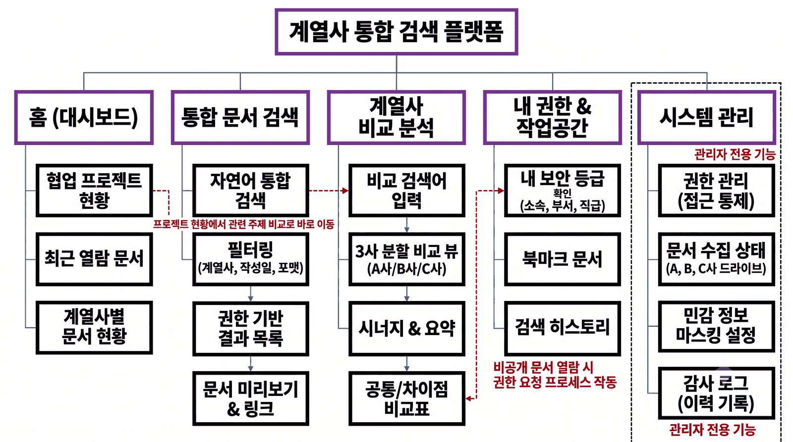

# spaceH

계열사 문서를 한 번에 검색하고, 회사별 관점을 나란히 비교하는 계열사 통합 검색 플랫폼입니다.

## 서비스 구조 (IA)



## 개발 문서

| 문서 | 내용 |
| --- | --- |
| [기능 목록](docs/features.md) | 28개 기능의 패키지·담당·일정·선행 |
| [구조 개요](docs/architecture/overview.md) | 전체 흐름, 권한 규칙, 패키지 사이 약속, 화면 |
| [데이터 모델](docs/architecture/data-model.md) | 공통 문서 형식, 마스킹·청킹, Chroma·DB 필드, 시드 계정 |
| [결정 기록](docs/decisions.md) | 이미 정한 것과 아직 정하지 않은 것 |
| [로컬 개발 환경](docs/workflows/local-development.md) | Python 3.11·가상환경·requirements.txt, OS별 설치·실행 |
| [코드 규칙](docs/conventions/coding.md) | 폴더 계층, 이름, DB, 보안 필수 규칙 |
| [Git 규칙](docs/conventions/git.md) | 브랜치 전략, 커밋, PR·리뷰 |
| [AI 활용 규칙](docs/conventions/ai.md) | AI 도구 사용 원칙, 검증 체크리스트 |
| [AGENTS.md](AGENTS.md) | AI coding agent용 안내 |

## 빠른 시작

```bash
python3.11 -m venv .venv && source .venv/bin/activate   # Windows: py -3.11 -m venv .venv; .venv\Scripts\Activate.ps1
pip install -r requirements.txt
cp .env.example .env                                     # 값 채우기 (Windows: copy)
streamlit run main.py
```

OS별 자세한 설치·문제 해결은 [로컬 개발 환경](docs/workflows/local-development.md)을 참고해 주세요.

## Git 컨벤션 요약

- `develop`이 기본 브랜치입니다. 이슈를 만든 뒤 `prefix/{이슈번호}-work-summary` 브랜치에서 작업하고 `develop`으로 PR을 보냅니다.
- 커밋: `prefix: #{이슈번호} 작업 요약` (예: `feat: #12 BM25 검색 결과 결합 구현`)
- PR 제목: `[PREFIX] #{이슈번호} 작업 요약`. 승인 1명 이상을 받으면 팀장이 머지 커밋으로 합칩니다.
- `main`에는 시연 가능한 상태만 둡니다.

자세한 규칙은 [Git 규칙](docs/conventions/git.md)을 따릅니다.
