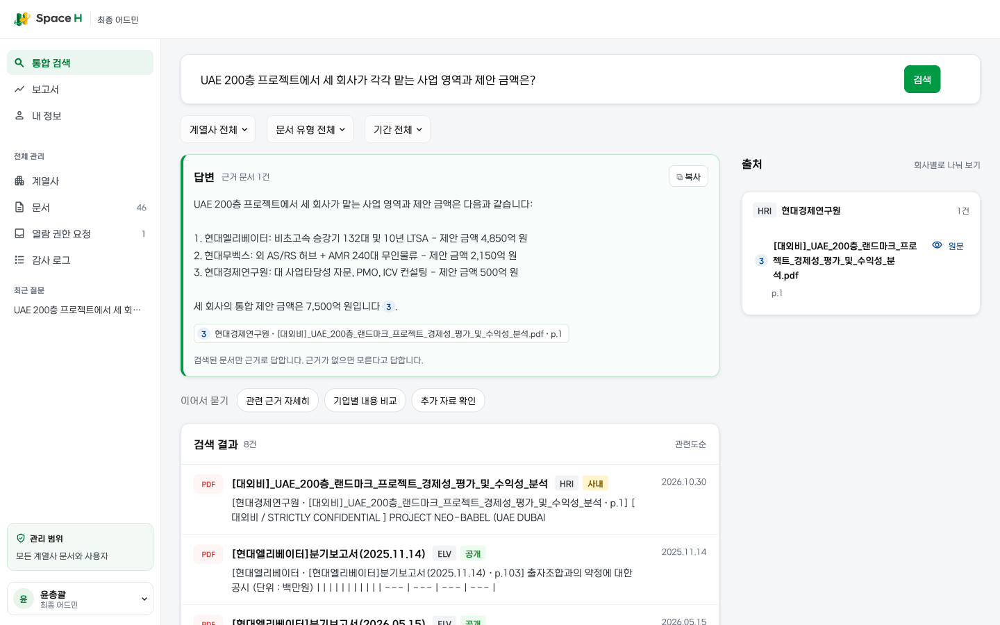
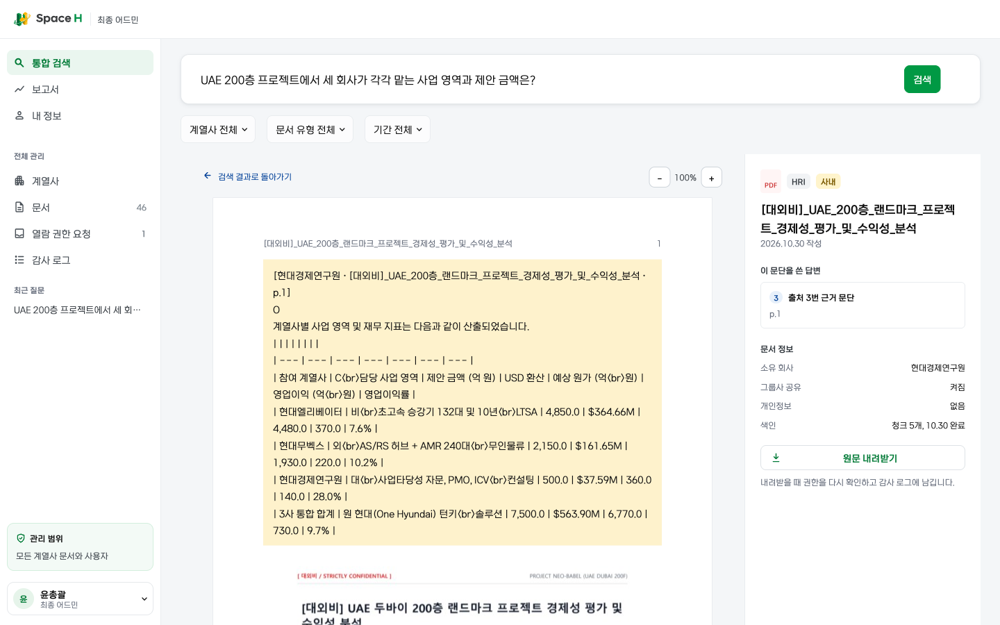
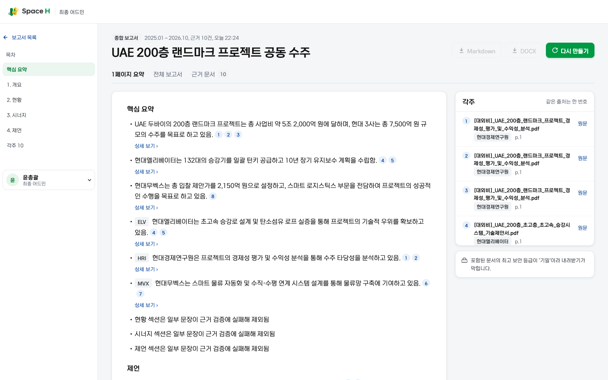
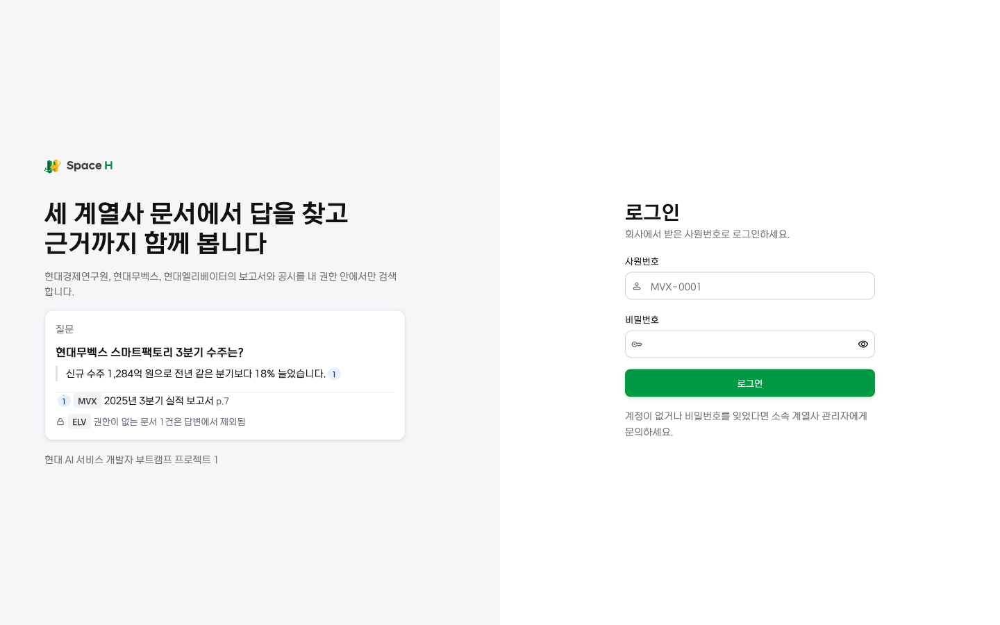
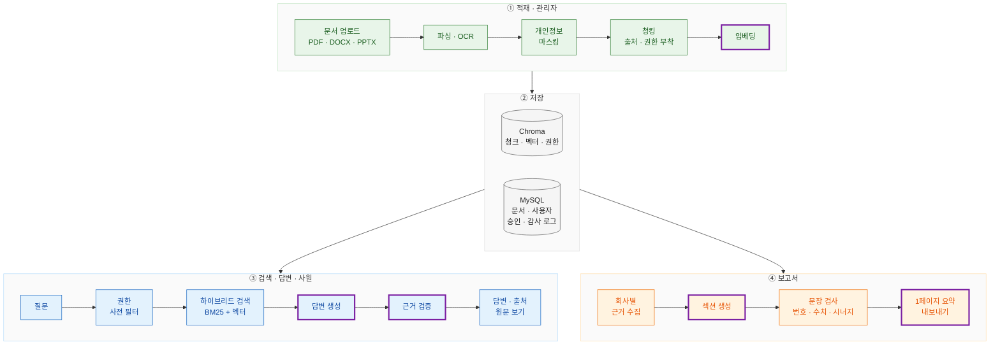

<div align="center">

# SPACEH

**계열사 문서를 권한 범위 안에서 한 번에 검색하고, 근거와 함께 답하고, 보고서로 만드는 RAG 플랫폼**

현대경제연구원 · 현대무벡스 · 현대엘리베이터


현대 AI 서비스 개발자 부트캠프 · 프로젝트 1 · TEAM SPACEH

</div>

---

## 개발 배경

| 문제 | SPACEH의 해결 |
| --- | --- |
| 계열사별로 흩어진 문서 | 세 회사 문서 **통합 검색**, 출처를 회사별로 나눠 표시 |
| 공개 문서와 기밀 문서의 혼재 | 권한 필터를 **검색 전에** 적용, 볼 수 없는 문서는 AI에도 미전달 |
| 그럴듯하게 지어내는 AI 답변 | 문장마다 **근거 번호 [n]** 표시, 코드와 AI 판정으로 다시 검사한 답만 노출 |

## 주요 기능

**검색 · 질의응답**
- 자연어 통합 검색 — BM25 키워드 검색과 벡터 검색을 RRF로 결합한 하이브리드 검색
- 회사 · 문서 유형 · 기간 필터, 권한 기반 사전 필터
- 근거 번호가 붙은 AI 답변과 원문 보기, 후속 질문 추천

**보고서**
- 주제로 세 회사의 연관 문서를 모아 개요 · 현황 · 시너지 · 제언 보고서 생성
- 문장별 근거 각주와 원문 연결, 의사결정용 1페이지 요약
- Markdown · DOCX 내보내기 (기밀 근거가 있으면 다운로드 차단, 그 외 워터마크)

**문서 적재**
- PDF · DOCX · PPTX 로더, 이미지 속 글자 OCR (EasyOCR)
- 연락처 · 이메일 · 계좌 자동 마스킹 후 청킹 · 임베딩 · 색인
- 중복 파일 확인, 실패 단계 안내, 재색인

**권한 · 관리**
- 역할 3단계(사원 · 계열사 관리자 · 최종 어드민) × 보안 등급 3단계(공개 · 내부 · 기밀)
- 그룹사 공유, 열람 권한 요청과 소유사 관리자 승인
- 감사 로그, 내 사용 기록, 계열사 추가

> 기능명세표 28개 중 26개를 구현했습니다. P3인 I-04(XLSX · HWP 파싱)와 I-05(DART 자동 수집)는 이번 버전에서 제외했습니다. 전체 목록은 [기능 목록](docs/features.md)에 있습니다.

## 화면

| 통합 검색 · 근거 답변 | 원문 보기 |
| :---: | :---: |
|  |  |
| 근거 번호가 달린 답변과 회사별 출처 | 답변이 인용한 문단을 원문에서 강조 표시 |
| **종합 보고서 · 1페이지 요약** | **로그인** |
|  |  |
| 세 회사 문서로 만든 보고서와 각주, 기밀 근거 포함 시 다운로드 차단 | 사원번호 로그인, 역할과 소속에 맞는 문서만 노출 |

## 시스템 구조



> 초록은 적재, 파랑은 검색·답변, 주황은 보고서 단계이고, 보라색 테두리는 OpenAI를 부르는 단계입니다. 권한 필터는 검색과 보고서 수집 **전에** 적용되어, 볼 수 없는 문서는 AI에 전달되지 않습니다.

### 권한 규칙

| 역할 \ 문서 | 공개 | 자사 내부 | 타사 내부 (공유 OFF) | 타사 내부 (공유 ON) | 자사 기밀 | 타사 기밀 |
| --- | :-: | :-: | :-: | :-: | :-: | :-: |
| 일반 사원 | ✅ | ✅ | 승인 시 | ✅ | 승인 시 | 승인 시 |
| 계열사 관리자 | ✅ | ✅ | 승인 시 | ✅ | ✅ | 승인 시 |
| 최종 어드민 | ✅ | ✅ | ✅ | ✅ | ✅ | ✅ |

- 타사 문서는 **그룹사 공유**(내부 문서만 가능)나 소유사 관리자의 **열람 승인**으로만 열립니다.
- 기밀 문서는 공유할 수 없고, 원문 보기 · 다운로드 · 보고서 파일처럼 문서가 밖으로 나가는 곳마다 권한을 다시 확인합니다.

## 설계 원칙

- **권한은 검색 전에 적용합니다.** 권한을 검색 조건(`where`)으로 바꿔 BM25와 벡터 검색에 똑같이 넣고, 결과를 받은 뒤 거르지 않습니다.
- **생성과 검증을 나눕니다.** 답변은 출처 번호 검사와 AI 내용 대조를 통과해야 나가고, 보고서는 문장마다 번호 · 수치 · 시너지 검사를 거쳐 재시도 · 문장 제거 · 섹션 포기 순서로 처리합니다.
- **모르면 막습니다.** 로그인이나 역할 정보가 이상하면 아무것도 보여 주지 않고, 원문 보기 · 다운로드처럼 문서가 밖으로 나가는 곳마다 권한을 다시 확인합니다.
- **계층을 지킵니다.** `views → services → repositories` 순서로 부르고, 화면은 판단하지 않으며, SQL은 `%s` 바인딩만 씁니다.

## 빠른 시작

**준비물**: Python 3.11, MySQL 8.0.16 이상, OpenAI API 키

```bash
# 1. 가상환경과 패키지
python3.11 -m venv .venv && source .venv/bin/activate   # Windows: py -3.11 -m venv .venv; .venv\Scripts\Activate.ps1
pip install -r requirements.txt

# 2. 환경 변수 (API 키, DB 접속 정보, 시드 비밀번호)
cp .env.example .env                                     # Windows: copy

# 3. DB · 테이블 · 계열사 · 시드 계정
mysql -u root -p -e "CREATE DATABASE IF NOT EXISTS spaceh CHARACTER SET utf8mb4 COLLATE utf8mb4_0900_ai_ci"
mysql -u root -p spaceh < db/schema.sql                  # 주의: 기존 테이블 삭제 후 재생성
mysql -u root -p spaceh < db/seed.sql
python -m scripts.seed_users

# 4. OCR 모델 (처음 한 번, 인터넷 필요)
python -m scripts.prepare_ocr

# 5. 실행 → http://localhost:8501
streamlit run main.py
```

시드 계정은 `ADM-0001`(최종 어드민), 사원 `HRI-0001` · `MVX-0001` · `ELV-0001`, 계열사 관리자 `HRI-0002` · `MVX-0002` · `ELV-0002`이고, 비밀번호는 `.env`의 `SEED_DEFAULT_PASSWORD`입니다. OS별 설치와 문제 해결은 [로컬 개발 환경](docs/workflows/local-development.md)을 참고해 주세요.

## 프로젝트 구조

```text
spaceh/
├── main.py              # Streamlit 진입점 · 화면 이동
├── core/                # 설정 · DB 연결 · 보안 · 상수
├── models/              # 공통 모델 패키지
├── app/
│   ├── auth/            # 로그인 (M-01)
│   ├── users/           # 내 정보 (M-02)
│   ├── permissions/     # 권한 필터 · 열람 요청 (S-03, M-03)
│   ├── search/          # 통합 · 하이브리드 검색, RAG 답변, 후속 질문 (S-01·02·04·06·07)
│   ├── documents/       # 출처 · 원문 보기 (S-05)
│   ├── ingestion/       # 로더 · OCR · 마스킹 · 청킹 · 색인 (I-01~I-03)
│   ├── admin/           # 업로드 · 문서 관리 · 공유 · 감사 로그 · 승인 · 계열사 (A-01~A-05, A-07)
│   ├── reports/         # 근거 수집 · 보고서 · 각주 · 요약 · 내보내기 · 다운로드 통제 (R-01~R-05, A-06)
│   ├── history/         # 내 사용 기록 (M-04)
│   └── common/          # 공통 레이아웃 · UI
├── db/                  # schema.sql · seed.sql
├── scripts/             # 시드 계정 · OCR 준비 · 실험 도구
├── tests/               # unittest
└── docs/                # 설계 · 규칙 · 결정 기록 · 실험
```

기능 패키지(`auth` · `users` · `permissions` · `search` · `documents` · `admin` · `reports` · `history`)는 `views`(화면) → `services`(업무 로직) → `repositories`(DB) 3계층입니다. `ingestion`은 `parsers` → `preprocessing` → `indexing` 적재 파이프라인이고, `core` · `models` · `app/common`은 공통 모듈입니다.

## 기술 스택

| 영역 | 기술 |
| --- | --- |
| 화면 | Streamlit |
| AI | OpenAI `gpt-4o-mini` (생성 · 판정), `text-embedding-3-small` (임베딩), LangChain |
| 검색 | Chroma (벡터), rank-bm25 (키워드), RRF 결합 |
| 문서 처리 | pdfplumber, python-docx, python-pptx, EasyOCR |
| 데이터 | MySQL 8, PyMySQL |
| 테스트 | unittest (표준 라이브러리) |

수업 범위 밖 라이브러리는 [결정 기록](docs/decisions.md)에 이유를 남기고 승인받아 추가했습니다.

## 팀원

| 이름 | GitHub | 역할 | 맡은 영역 |
| --- | --- | --- | --- |
| 이현종 | [@Navi-Up](https://github.com/Navi-Up) | 팀장 | DB · 설정 · 통합 · 테스트 |
| 이서현 | [@SeoHyun1024](https://github.com/SeoHyun1024) | 검색 · 계정 | 통합 검색, 권한 필터, 하이브리드 검색, 사용 기록 |
| 이상훈 | [@sh5316](https://github.com/sh5316) | 검색 · 계정 | 검색 필터, 후속 질문, 로그인, 내 정보, 권한 요청 |
| 정재연 | [@jaeyeonjeong62](https://github.com/jaeyeonjeong62) | 문서 · 관리자 | 파일 로더, 청킹 · 색인, 업로드, 권한 승인 |
| 이승준 | [@s-zuni](https://github.com/s-zuni) | 문서 · 관리자 | 마스킹, 문서 관리, 공유, 감사 로그, 다운로드 통제, 계열사 추가 |
| 김소은 | [@soeundipia-teez](https://github.com/soeundipia-teez) | 답변 · 보고서 | 근거 답변, 보고서 근거 수집, 각주 |
| 박예원 | [@yewon-studio](https://github.com/yewon-studio) | 답변 · 보고서 | 원문 보기, 보고서 생성, 1페이지 요약, 내보내기 |

## 개발 문서

| 문서 | 내용 |
| --- | --- |
| [기능 목록](docs/features.md) | 28개 기능의 패키지 · 담당 · 일정 · 선행 |
| [구조 개요](docs/architecture/overview.md) | 전체 흐름, 권한 규칙, 패키지 사이 약속, 화면 |
| [데이터 모델](docs/architecture/data-model.md) | 공통 문서 형식, 마스킹 · 청킹, Chroma · DB 필드, 시드 계정 |
| [보고서 설계](docs/architecture/report.md) | 보고서 수집 · 생성 · 검증 · 각주 |
| [결정 기록](docs/decisions.md) | 이미 정한 것과 아직 정하지 않은 것 |
| [실험 기록](docs/experiments/README.md) | 청크 크기 · 겹침 비교 |
| [로컬 개발 환경](docs/workflows/local-development.md) | OS별 설치 · 실행 · 문제 해결 |
| [코드 규칙](docs/conventions/coding.md) · [Git 규칙](docs/conventions/git.md) · [AI 활용 규칙](docs/conventions/ai.md) | 팀 규칙 |

## 협업 방식

- `develop`이 기본 브랜치입니다. 이슈 → `prefix/{이슈번호}-work-summary` 브랜치 → `develop`으로 PR을 보냅니다.
- 커밋은 `prefix: #{이슈번호} 작업 요약`, PR 제목은 `[PREFIX] #{이슈번호} 작업 요약` 형식입니다.
- 모든 PR은 리뷰 승인 1명 이상을 받은 뒤 팀장이 merge commit으로 합칩니다. `main`에는 시연 가능한 상태만 둡니다.
